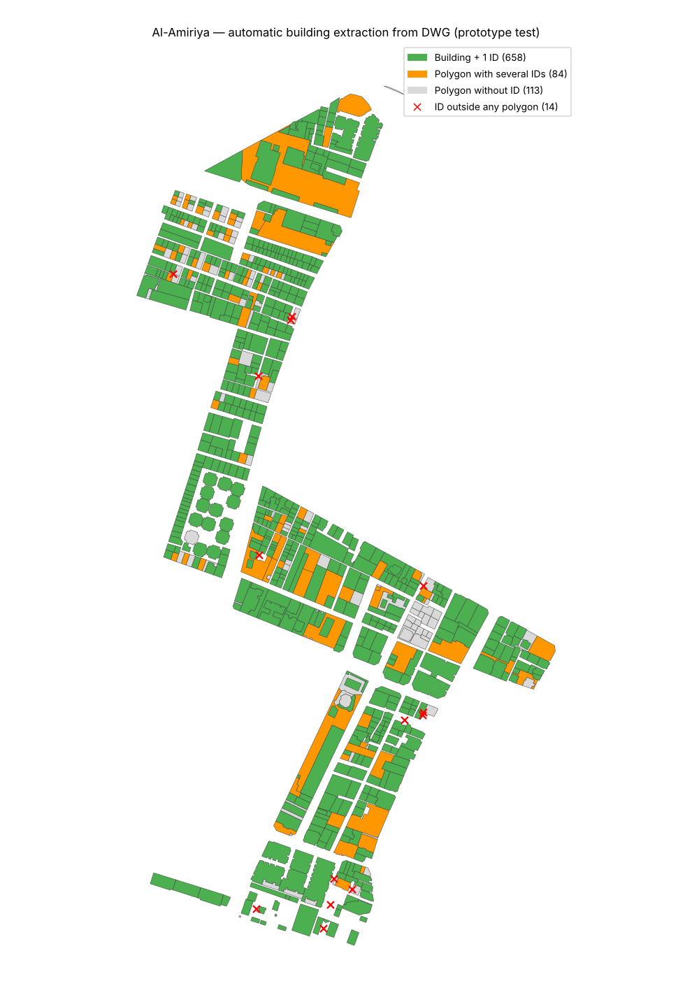

# Reference project: Al-Amiriya (الاميرية) — Stage 01 files

## Stage 01 input
`الاميرية ftth.kml` (exported from Google Earth Web)
- 1 Polygon "الاميرية 2026" — project boundary, 20 vertices, valid. Area ≈ 36.1 ha, perimeter ≈ 4.7 km.
- 1 Point note: "يوجد داخل هذه المنطقة ام سان 80&13 تم احلالهم ftth" (MSAN cabinets 80 & 13 replaced by FTTH).
- Parser notes: ignore `gx:CascadingStyle` styles; drop altitude; Arabic names.

## Stage 01 outputs
### `CAD الاميرية V1 11-10.dwg`
- Format AC1024 (AutoCAD 2010). Units metres. Coordinates **UTM 36N (EPSG:32636)**.
- Layers / entities:
  | Layer | Content | Count |
  |---|---|---|
  | `مناطق سكنيه` | Building outlines, LWPOLYLINE (only 24 closed) | 1,103 |
  | `Serial Home` | TEXT `ERA <n>`, height 1.0 | 857 (ERA 0–856, no gaps, no duplicates) |
  | `TEXT نص الدلتا 4-4` | Street/lane names, style `x` = font `xarb.shx` (legacy, non-Unicode) | 73 TEXT + 1 MTEXT |
  | `baldimg` | 2 HATCH + 1 polyline (red area in plots) — meaning TBC | 3 |
  | `0` | Project boundary + 2 points | — |
  | `500`, `2500`, `1-500` | Print frames / block `dddfffff` | — |
- One INSERT (layer `500`) located far outside the project (x≈103,365) → clip to boundary on import.

### `KMZ الاميرية V1 7-10.kml` (CAD-Earth export)
- Only line geometry: placemark `مناطق سكنيه` (1,061 LineString + 42 LinearRing) and boundary on layer `0`.
- No IDs, no street names, no hatch.
- **Dated 7-10 while DWG is 11-10** → may be out of sync.

### PDFs
- `General … V1 11-10` — 1 × A0 overview plot (AutoCAD).
- `CAD … V1 11-10 Frame_5` — 5 × A0 survey sheets (frames), surroundings hatched red.

## Automatic extraction test (tools/extract_buildings.py)
polygonize(building lines) + point-in-polygon on `ERA` labels:

| Result | Count |
|---|---|
| Polygon with exactly 1 ID | 658 (77%) |
| Polygon with several IDs (missing dividing line) | 84 |
| Polygon without ID (courtyards/gaps) | 113 |
| ID outside any polygon | 14 |

→ ~3/4 of Stage 03 polygon work can be automated; the rest becomes a review screen.
